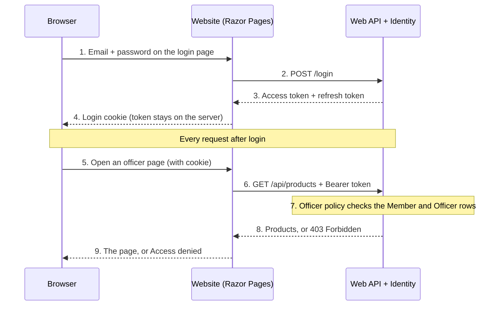

# CAR-52: Login Approach

**Issue:** CAR-52 · **Author:** Dylan Morzfeld · **Last updated:** 2026-10-20

**Recommendation:** use ASP.NET Core Identity in the Web API, with its accounts stored in our PostgreSQL database. The browser logs in to the website with a normal cookie; the website calls the API with the user's bearer token. Officer and member access is checked against the Member and Officer rows, not just a role name, as the proposal requires.

| Acceptance criterion | Covered in |
| --- | --- |
| Identity for our setup (Razor Pages site plus Web API): cookie or token login, where the user account lives | Sections 1 and 2 |
| How a login links to Customer → Member → Officer (CAR-28) | Section 3 |
| How officer-only pages and member pricing check access (replacing the `[Authorize]` TODOs) | Section 4 |
| Sprint 4 stories drafted | Section 5 |

## 1. Options compared

Identity in the API is the only option that protects both the website and the API while keeping our rule that the website never touches the database.

| | A. Identity in the API (recommended) | B. Identity in the website | C. External sign-in (school Microsoft account) |
| --- | --- | --- | --- |
| Where accounts live | `AspNetUsers` tables in our PostgreSQL database, managed by the API | Same tables, but the website reads them directly | Microsoft holds the password; we still need our own user row |
| Login | Website login page sends email and password to the API's `/login`; the website keeps a cookie | Built-in Identity login pages in the website | Redirect to Microsoft and back |
| Protects the API | Yes: every API call carries the user's token | No: the API can't tell who is asking | Yes, with extra setup |
| Fits our layers | Yes | No, the website would query the database | Yes |
| Guests (non-students) | Can register | Can register | Can't sign in without a school account |
| Setup effort | Medium: built-in endpoints plus one login page | Low | High: app registration in the school's Microsoft tenant, which we don't control |

**Why A:** .NET 8 and later include ready-made Identity endpoints for an API (`AddIdentityApiEndpoints` and `MapIdentityApi`: register, login, refresh, password reset). Microsoft recommends cookies for browsers and tokens for other callers, which is exactly our split: the browser only talks to the website, and only the website talks to the API. The built-in tokens are Identity's own format (not JWTs), which is fine because only our website ever reads them. External sign-in can be added to Identity later if the club wants it.

## 2. How login works

The token never reaches the browser: the website keeps it with the login cookie and adds it to each API call from `ProductsApiClient`. The API makes the real access decision, so an officer page is safe even if someone types its URL.

## 3. Linking a login to Customer, Member and Officer

Each login points at one Customer; whether that person is a Member or Officer is read from the CAR-28 tables every time, so access follows their real membership.

| Who | How we know | Source |
| --- | --- | --- |
| Logged-in user | An `AppUser` (our `IdentityUser` subclass) with a required, unique `CustomerId` | New: `AppUser.CustomerId` → `Customers` |
| Guest | Has a Customer, no current Member row | ERD: Customer |
| Member | `Members` row where `MemberId = CustomerId`, `IsActive` is true and `MemberExpiration` is today or later (club time, America/Chicago) | CAR-28 status rules |
| Officer | A current Member who also has an `Officers` row | CAR-28; proposal: "checks for a matching Officer row, not just a role claim" |

- **Register** creates the `Customer` and the `AppUser` in one transaction, so there's never a login without a customer.
- **Membership changes** (dues expire, admin marks someone as left) take effect on the next request, because nothing is cached in the login itself.
- **Identity tables** go into our existing `AppDbContext` (it becomes an `IdentityDbContext<AppUser>`), so there's one database and one migration history.

## 4. Access checks that replace the TODOs

Two named policies, `Member` and `Officer`, do all the checking; each TODO in the code becomes one line that uses them.

| Today (TODO) | After login | Where |
| --- | --- | --- |
| Every `Pages/Officer/*` page: "add [Authorize] once login is wired up" | One line in the website's `Program.cs`: `AuthorizeFolder("/Officer", "Officer")` locks the whole folder | `frontend/CCOS.Web/Program.cs` |
| `?includeInactive=true` open to anyone | `[Authorize(Policy = "Officer")]` on the officer list; create, update and deactivate endpoints get the same | `backend/CCOS.Api/Controllers/ProductsController.cs:20` |
| `CanSeeMemberPrice()` always returns `true` | Returns true only when the caller passes the `Member` policy; guests get `MemberPrice = null` | `backend/CCOS.Api/Controllers/ProductsController.cs:57` |
| Members-only events | Same `Member` policy before a members-only ticket can be bought | Events API (Sprint 4–5) |

- **How a policy decides:** a small authorization handler in the API looks up the caller's `CustomerId`, then checks the Member and Officer rows as in Section 3.
- **The website shows or hides links** (like the Officer Dashboard in the footer) with the same policies, but the real guard is the API, so a hidden link is never the only protection.

## 5. Sprint 4 stories

Four stories cover login for Sprint 4, roughly 15–18 points, under epic CAR-18.

| Story | What it delivers | Rough size |
| --- | --- | --- |
| [DB] Customer, Member, Officer tables + Identity | `Customers`, `Members`, `Officers`, `OfficerHistory` from CAR-28, Identity tables, `AppUser.CustomerId`, one migration | 5 |
| [Backend] Login API and access policies | `MapIdentityApi`, a `GET /api/me` that returns the caller's customer, member and officer status, the `Member` and `Officer` policies, tests | 5 |
| [Frontend] Login, register and logout pages | Website cookie login, the token sent on every API call, "Log in" / "Log out" in the nav | 3 |
| [Full stack] Lock officer pages and member pricing | The four changes in Section 4 | 2–3 |

## Sources

- [Microsoft: Use Identity to secure a Web API backend](https://learn.microsoft.com/en-us/aspnet/core/security/authentication/identity-api-authorization)
- `docs/Jira-Archive/Membership Lifecycle & Deactivation Schema.md` (CAR-28)
- `docs/Project Proposal_ Cyber Cougars Club Order & Event System (CCOS).md`, User Roles & Auth
